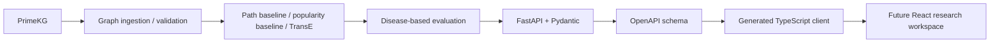

# RepurposeMap

RepurposeMap is an explainable drug-repurposing research system. It:

- ranks existing drugs as candidates for a disease over a biomedical knowledge graph (PrimeKG)
- explains why a candidate is suggested using the biological graph paths that connect it to the disease
- is designed to later attach literature, trial and safety evidence to each candidate (not implemented yet)
- is **research decision-support only, not clinical treatment advice**

Every output is a **research hypothesis that requires expert review**.

## Important: research use only

RepurposeMap is **not** a treatment recommendation system. It does not:

- recommend drugs to patients
- give dosing or clinical advice
- claim that any drug treats any disease, or that any ranked candidate is clinically efficacious
- treat a path in the graph as evidence that a drug works. Connectivity in a knowledge graph is not evidence of treatment efficacy.
- treat future evidence/safety lookups (PubMed, ClinicalTrials.gov, DailyMed, openFDA) as anything beyond research context for a human reviewer

## Architecture



See [API.md](API.md) for the FastAPI / OpenAPI / TypeScript boundary in detail.

## Project status

**Completed**

- PrimeKG ingestion (real dataset adapter, canonical node IDs, provenance fingerprinting)
- Graph exploration (statistics, entity search, bounded path finding, CLI)
- Path-quality baseline (relation policy, hub and drug-promiscuity penalties, drug ranking)
- Popularity baseline (full 7,957-drug-universe ranking by graph degree)
- Leakage-safe, disease-based evaluation harness (split, training-graph construction, leakage checks, metrics)
- TransE foundation (model, training loop, triples export, CLI commands)
- TransE Stage D GPU profiling (plumbing/throughput validation on a Kaggle T4; not a trained checkpoint or a benchmark result)
- Typed API foundation (FastAPI + Pydantic, OpenAPI export, generated TypeScript client)
- Experiment/model provenance layer (`repurposemap.provenance`): reads `ml/experiments/*.json` and reports honest model-eligibility status through `GET /api/v1/system/info`, without loading PrimeKG or a checkpoint
- React research workspace (`web/app`): disease-query UI over the generated TypeScript client, with system-status, candidate, evidence, explanation-path and safety panels -- shows the honest "no model available" state today, never a fake ranking
- Evidence and safety domain foundation (`repurposemap.evidence`): typed contracts and adapter interfaces for future PubMed/ClinicalTrials.gov/DailyMed/openFDA lookups; no live adapter yet
- `RepurposingHypothesis` domain object (`repurposemap.hypothesis`): shows how model score, explanation paths, evidence and safety will assemble once a real model and real adapters exist
- 3-config TransE validation search (Kaggle, GPU) — see [ml/experiments/transe_stage_d_validation_search_606711d.json](ml/experiments/transe_stage_d_validation_search_606711d.json)
- Final TransE training (`search-dim128`, 4 epochs, Kaggle GPU) and the exactly-once locked-test evaluation — see "Final TransE result (locked test)" below and [ml/experiments/transe_stage_d_final_locked_test_c8997e9.json](ml/experiments/transe_stage_d_final_locked_test_c8997e9.json)

**Planned**

- R-GCN (relational GNN), evaluated using the same locked-test discipline (selected on training/validation only — the locked test used above has now been observed once and must not become an iterative tuning set for this or any future model)
- Real PubMed/ClinicalTrials.gov/DailyMed/openFDA adapters behind the evidence domain foundation above

Do not treat anything in "planned" as complete or benchmarked.

## Milestone history

Milestone 1 (exploring the graph) is complete. It covers real PrimeKG integration, canonical node IDs, statistics, entity search, bounded path finding and the CLI.

Milestone 2 added the relation policy, hub and drug-promiscuity penalties, the path-quality score, and the first drug-ranking baseline.

Milestone 3 added disease-based evaluation:

- **Disease-based evaluation.** Known indications are split by *disease ID*, not by edge: every treatment of a held-out disease is removed, all at once, into one training graph. See "why not split by edge" in [ml/README.md](ml/README.md).
- **Explicit leakage checks** that fail loudly if a held-out treatment edge, or a train/test overlap, is found.
- **Model-agnostic metrics.** Filtered rank, Hits@1/3/10 and MRR, built to score any future ranking (the path baseline today, TransE or an R-GCN later) without change.
- **Random-order baseline**, over the same candidates the path baseline found, for a fair comparison.
- **Updated `evaluate-baseline` CLI command**, now disease-based: `--test-diseases`, `--test-fraction`, `--seed`.

A follow-up milestone hardened this evaluation before building TransE on top of it:

- **Reverse-edge leakage protection.** The leakage check now catches a held-out indication edge in *either* direction (`drug -> disease` or `disease -> drug`), not just the forward one.
- **Popularity baseline.** A second non-learning baseline that ranks all 7,957 PrimeKG drug nodes by raw graph degree, computed once from the leakage-safe training graph, fully independent of the path baseline's own candidate search.
- **The existing random baseline is now labeled explicitly as candidate-conditioned** — it shuffles only the path baseline's own discovered candidates, not the full drug universe, which the popularity baseline above now covers.
- **Dataset provenance and a reproducible result artifact.** Every benchmark run can record a PrimeKG file SHA-256, retrieval date, DOI, the exact seed and configuration, and the git commit it ran from.

On a controlled 100-disease, 498-pair benchmark (seed 42), the path baseline scores Hits@10 = 0.086 and MRR = 0.033, against Hits@10 = 0.006 and MRR = 0.0048 for the candidate-conditioned random baseline, and Hits@10 = 0.014 and MRR = 0.0062 for the full-universe popularity baseline — the path baseline is the strongest of the three on every metric. Absolute performance is still weak. This is a small, controlled evaluation, not a validated benchmark, and these numbers are not clinical evidence; the baseline and the harness exist as a comparison point for TransE and R-GCN. Details, plus the smaller 20-disease sanity check, in [ml/README.md](ml/README.md).

Not implemented yet, as of this writing:

- **No R-GCN or other relational GNN.** TransE has now completed final training and its one-time locked-test evaluation (see "Final TransE result (locked test)" below); R-GCN has not been started.
- No live evidence lookup (PubMed, ClinicalTrials.gov, DailyMed, openFDA) and no real drug safety information -- only the typed domain contracts and adapter interfaces exist (`repurposemap.evidence`).
- The React frontend (`web/app`) exists and queries the real API, but since no model is available yet it only ever shows the honest unavailable/empty state -- see "Project status" above and [API.md](API.md).

## Evaluation protocol

The split is **by disease**, not by edge: every indication edge of a held-out disease is removed from training in both directions (`drug -> disease` and `disease -> drug`), all at once. See "Why not split by edge" in [ml/README.md](ml/README.md).

- **100 locked test diseases**, holding out **498 indication pairs**, fixed once by `repurposemap.embeddings.export` and recorded in a local-only `locked_test_manifest.json` (never uploaded to Kaggle, never used for tuning).
- A separate **validation** split (distinct from the locked test) is what the 3-config search used for model selection.
- The locked test is evaluated **exactly once**, after final training — `assert_eligible_for_locked_test_evaluation` refuses the run unless the checkpoint is marked `is_final_training`, the manifest's export fingerprint matches the checkpoint's, and the manifest's recomputed content fingerprint matches what the checkpoint recorded as expected.
- Locked-test labels are kept out of the Kaggle training environment entirely; only `triples.npz`, `metadata.json` and `validation_indications.json` are uploaded.
- No test-driven retuning: hyperparameters are chosen on validation metrics, never on the locked test.

Metrics, computed per held-out `(drug, disease)` pair with filtered ranking (`repurposemap.evaluation.metrics`):

- Hits@1, Hits@3, Hits@10
- MRR (mean reciprocal rank)
- Macro Average Precision (mean of each disease's own AP over its candidate universe)
- Micro Average Precision (pooled over all pairs)

**AP means true, non-interpolated Average Precision** (`AP = (1/n_positives) * sum(precision@k for every k where label_k == 1)`), per `repurposemap.evaluation.metrics.average_precision`. Earlier, informal trapezoidal PR-AUC numbers from this project are **not** AP and must not be presented as such.

### Baseline fairness

- The **path baseline** ranks only the bounded candidate set it discovers per disease (at most `max_candidates`, nearest-first).
- The **popularity** and **TransE** baselines rank the full 7,957-drug PrimeKG universe.
- All three share the same held-out pairs and metric formulas, but they are **not a perfectly apples-to-apples candidate-ranking task** — the path baseline's candidate pool is a strict subset of the other two's. Any "N times better" comparison between them should carry this caveat; see "Random baseline (candidate-conditioned)" and "Popularity baseline" in [ml/README.md](ml/README.md) for how each ranking is constructed.

## Final TransE result (locked test)

TransE's final checkpoint (`search-dim128`, embedding_dim=128, L2 distance, margin=1.0, lr=1e-3, 4 negatives per positive, 4 final-training epochs, selected by the 3-config validation search) was evaluated against the 100 locked test diseases / 498 held-out pairs **exactly once**, per the protocol above. Full provenance and metrics: [ml/experiments/transe_stage_d_final_locked_test_c8997e9.json](ml/experiments/transe_stage_d_final_locked_test_c8997e9.json).

| | Hits@1 | Hits@3 | Hits@10 | MRR |
|---|---|---|---|---|
| Path baseline (bounded candidates) | 0.01004 | 0.04016 | 0.08635 | 0.03329 |
| Popularity baseline (full universe, *approximate*) | 0.0 | ~0.004 | ~0.014 | ~0.0062 |
| **Final TransE (full universe)** | **0.0020** | **0.0040** | **0.0161** | **0.0100** |

Popularity's values are marked approximate because this repo currently only has them recorded to that precision.

**Candidate-universe caveat (same one as above, restated for this table):** the path baseline ranks a bounded, per-disease discovered candidate set (0–500 candidates); popularity and TransE both rank the full 7,957-drug universe for every disease. All three share the same held-out pairs and metric formulas, but this is not the same ranking task, so no "TransE is N times better/worse than path" claim should be made from this table alone.

**Interpretation.** Final TransE did not outperform the existing path baseline on the locked test, and landed only modestly above — or broadly near — the simple non-learning baselines on several of these metrics. This does not mean the project has failed: it means a pure translational embedding model, evaluated on this split, is not yet a strong candidate-ranker on its own. It motivates testing a relation-aware graph neural network (R-GCN) next, since R-GCN can condition directly on PrimeKG's typed relational structure the way the path baseline already does, rather than compressing it into a single embedding geometry the way TransE does. This result does not establish clinical efficacy for any candidate, and should not be read as one.

## Data

### PrimeKG (real dataset, local only)

- **Dataset:** PrimeKG, the Precision Medicine Knowledge Graph.
- **Source:** Harvard Dataverse, https://doi.org/10.7910/DVN/IXA7BM (persistent identifier `doi:10.7910/DVN/IXA7BM`).
- **File used:** `kg.csv`, the edge file. It holds 8,100,498 edges over 129,375 nodes.
- **Retrieved:** 5 October 2026.
- **SHA-256 (of `kg.csv`, 981,751,236 bytes):** `0a5a010fcd88dcec572a573d98c26c1c244a11567092b6161d3ded611cfb5c69`. Computed read-only (verified not to modify the file or its mtime); see `repurposemap.adapters.primekg.compute_file_fingerprint`. Recorded here, and in each benchmark result artifact, so a result can be tied to the exact bytes it was computed from.
- **Release version:** not yet recorded. The Dataverse page could not be read from this environment when the file was retrieved, so the version and its date must be checked and added here.
- **Snapshot/build date:** not yet recorded, for the same reason as release version above. Not to be confused with, or substituted by, the local filesystem retrieval date above — that is when this copy was downloaded, not when PrimeKG itself was built.
- **Dataset terms:** not yet verified. The PrimeKG GitHub README says the code is MIT licensed, but dataset use is governed by separate terms. It also says each of the 20 integrated resources has its own license. Check those terms before redistributing any PrimeKG data.
- **Citation:** Chandak P, Huang K, Zitnik M. Building a knowledge graph to enable precision medicine. *Scientific Data* 10, 67 (2023). https://doi.org/10.1038/s41597-023-01960-3

Local-only status:

- The raw `kg.csv` is **local-only**. Place it at `data/raw/primekg/kg.csv`. The CLI reads it from there by default, or from `--csv PATH`.
- `data/raw/` is listed in `.gitignore`, so the raw file is not committed.
- No PrimeKG rows are committed to this repository.

### Test fixture (synthetic)

- **`ml/tests/fixtures/primekg_mini.csv`** is a **fully synthetic** 15-row file. It has PrimeKG's real 12-column schema, node types and relation labels. Its names and identifiers are invented (`DEMO ...`, `DEMO-...`), and its node indices are invented too. No real PrimeKG row is copied.
- The tests use this fixture so they do not need the 936 MB raw file.

### Synthetic demo graph

- **`data/sample/synthetic_demo_graph.csv`** is **synthetic demo data**: 15 entities and 23 relationships. Every entity name starts with `DEMO`. The entities and relationships are invented to exercise the code. They are **not** real biology and must not be cited as facts.

## Setup

Requires Python 3.12. Run these commands from the repository root:

```bash
python3.12 -m venv .venv
source .venv/bin/activate
python -m pip install -e ".[dev]"
```

The dependencies are pandas and networkx. pytest is a development dependency.

## Run the tests

```bash
python -m pytest
```

The tests use the synthetic sample and the small PrimeKG fixture. They run in about a second.

## Run the CLI

The CLI reads the synthetic demo graph by default. Add `--source primekg` to read PrimeKG. Add `--csv PATH` to read a different edge file.

```bash
# synthetic demo (default)
python -m repurposemap stats
python -m repurposemap search --query "drug"
python -m repurposemap paths --source-name "DEMO Drug Alpha" --target-name "DEMO Disease Zeta"

# real PrimeKG (needs data/raw/primekg/kg.csv)
python -m repurposemap stats --source primekg
python -m repurposemap search --source primekg --query "sildenafil"
python -m repurposemap search --source primekg --query "metformin" --max-results 5
python -m repurposemap paths --source primekg --source-name "sildenafil" --target-name "pulmonary arterial hypertension"
python -m repurposemap paths --source primekg --source-id 14937 --target-id 38436 --max-path-length 2

# path quality: raw shortest paths next to quality-ranked paths
python -m repurposemap explain-paths --source primekg --source-name "sildenafil" --target-id 38436

# drug-ranking baseline (research hypothesis ranking, not a treatment recommendation)
python -m repurposemap rank-drugs --source primekg --disease "pulmonary arterial hypertension" --top-k 10

# disease-based evaluation, with a random-order baseline for comparison (not a benchmark)
python -m repurposemap evaluate-baseline --source primekg --test-diseases 20 --seed 42
```

The scoring commands (`explain-paths`, `rank-drugs`, `evaluate-baseline`) need `--source primekg`. Their relation policy is written for PrimeKG. Full options and the formulas are in [ml/README.md](ml/README.md).

Options:

- `--source {sample,primekg}`: which dataset to load. Default `sample`.
- `--csv PATH`: the edge file to load. Defaults: `data/sample/synthetic_demo_graph.csv` or `data/raw/primekg/kg.csv`.
- `search --query TEXT` and `search --max-results N` (default 10).
- `paths` takes each endpoint either as `--source-name` / `--target-name`, or as `--source-id` / `--target-id`. Exactly one is required for each endpoint.
- `paths --max-path-length N` (default 4 hops), `--max-results N` (default 10 paths), and `--time-limit SECONDS` (default 20).

The `paths` options `--source` and `--target` now name the endpoints as `--source-name` and `--target-name`. `--source` selects the dataset.

### Name ambiguity

Several PrimeKG entities share a name. The fixture has two entities named `DEMO Compound Pi`, a drug and an exposure, so the same ambiguity can be reproduced on the test data. A name that matches more than one entity is an error. The error lists each candidate with its ID, so you can choose by ID:

```
error: source name 'DEMO Compound Pi' matches 2 entities. Use --source-id:
  id=105  DEMO Compound Pi (drug, external_id=DEMO-DRUG-PI)
  id=106  DEMO Compound Pi (exposure, external_id=DEMO-EXP-PI)
```

The CLI never picks one of several candidates silently.

## Node identity

- **Graph key:** PrimeKG's node index, written as a string such as `"14937"`. It is unique for each node in the file.
- **Why not the source ID:** PrimeKG's `*_id` values are not unique. Some are shared across node types, and some gene IDs are shared within a type. The index is the only reliable unique key in the file.
- **Attributes on each node:** `name`, `node_type`, `external_id` (PrimeKG's `*_id`, such as a DrugBank ID for a drug) and `provenance` (PrimeKG's `*_source`, such as `DrugBank`).
- **Search** returns the ID, name, type, and external ID.
- **Path output** shows names. The header shows each endpoint's ID when its name is not unique.

The synthetic sample has no IDs, so its node key is its name.

## Relation direction

Edges keep the direction stored in the file. The adapter does not add reverse edges, and it does not assume that a relation is symmetric. In the full file, every relation is listed in both directions, so the stored direction and the reverse edge are both present. The adapter keeps whatever the file contains.

Each edge carries `relation` and `display_relation`. Edges between one node pair are kept separately when they have different relations or labels. For example, the fixture's `DEMO Compound Pi` and `DEMO Protein Rho` are linked by both a `carrier` and a `target` edge.

## Path-search limits

Path search is bounded. It does not enumerate every path in PrimeKG.

- It returns paths **shortest first**. Within one length, the order follows the file and is deterministic.
- It stops as soon as `--max-results` paths are found.
- It never walks more than `--max-path-length` hops (default 4).
- It stops at a time limit (`--time-limit`, default 20 seconds) or an edge-check budget. When it stops early it says so. An empty result with "stopped early" does **not** mean that no path exists.
- It does not rank paths by biological relevance.

## Performance on the full PrimeKG file

Measured on this machine, an 8-core Mac with 8 GB RAM. Three full loads were timed, and the values below are the ranges seen:

- Load: about 75 to 125 seconds, from the start of the process to the finished graph. Peak memory footprint: 5.2 to 6.3 GB.
- Entity search by name: about 150 to 170 milliseconds.
- Bounded path query: under 0.3 seconds for the queries tested.

The full graph is held in memory by NetworkX. The machine needs roughly 6 GB free to load it, so close other large applications first.

## Troubleshooting

**`No module named repurposemap`.** The editable install did not take effect. This happened on macOS when the repository sat in an iCloud-synced folder such as `~/Desktop`. macOS marked the `.pth` file hidden, and Python ignores hidden `.pth` files. Two options:

- Create the virtual environment outside the synced folder, for example `python3.12 -m venv ~/.venvs/repurposemap`, then reinstall with `pip install -e ".[dev]"`.
- Run the CLI without installing, from the repository root: `PYTHONPATH=ml/src python -m repurposemap stats`.

Tests do not need either fix. `pyproject.toml` sets `pythonpath = ["ml/src"]` for pytest.

## Repository layout

```
RepurposeMap/
├── pyproject.toml          # package metadata, dependencies, pytest settings
├── README.md
├── API.md                  # FastAPI / OpenAPI / TypeScript client boundary
├── openapi.json             # exported OpenAPI schema (generated, committed)
├── data/
│   ├── raw/                # real datasets such as PrimeKG (gitignored)
│   └── sample/             # synthetic demo data (committed)
├── web/client/              # generated TypeScript client + hand-written wrapper
└── ml/
    ├── README.md           # graph exploration, scoring, and evaluation details
    ├── experiments/         # versioned JSON result/profile artifacts
    ├── kaggle/               # Kaggle-side TransE training runner
    ├── scripts/              # export_openapi.py and other one-off scripts
    ├── src/repurposemap/   # Python package
    │   ├── cli.py          # command-line interface
    │   ├── adapters/       # source-specific parsing (PrimeKG)
    │   ├── graph/          # generic loader, stats, search, bounded paths
    │   ├── scoring/        # relation policy, hub penalty, path-quality score
    │   ├── ranking/        # drug-ranking baseline
    │   ├── evaluation/     # held-out indication harness, metrics, TransE evaluation
    │   ├── embeddings/      # TransE model, training, export, locked-test manifest
    │   └── api/             # FastAPI app, Pydantic schemas, routes
    └── tests/              # pytest suite, fixtures and small test graphs
```

## Reproducibility

Run from the repository root (see "Setup" above for the virtualenv).

```bash
# tests
python -m pytest

# graph exploration
python -m repurposemap stats --source primekg
python -m repurposemap search --source primekg --query "sildenafil"

# path baseline evaluation (disease-based, with random/popularity baselines)
python -m repurposemap evaluate-baseline --source primekg --test-diseases 100 --seed 42 \
  --artifact ml/experiments/my_run.json

# TransE Stage D export (triples + validation-only package; see ml/README.md and
# ml/src/repurposemap/embeddings/export.py for the locked-test manifest split)
python -m repurposemap transe-export --help

# API startup
pip install -e ".[api]"
uvicorn repurposemap.api.app:app --reload

# OpenAPI export
PYTHONPATH=ml/src python ml/scripts/export_openapi.py

# TypeScript client generation
cd web/client && npm install && npm run generate && npm run typecheck
```

Experiment artifacts (dataset provenance, git commit, config, metrics, runtime) live in `ml/experiments/`, written via `evaluate-baseline --artifact PATH` or the TransE Stage D profiling script. They are versioned JSON, not raw data or checkpoints.

## Scientific scope

RepurposeMap generates research hypotheses for expert review. It does not prescribe drugs, recommend doses, or claim clinical efficacy for any candidate. Planned evidence and safety lookups (PubMed, ClinicalTrials.gov, DailyMed, openFDA) will surface research context for a reviewer, not a clinical verdict.

## Roadmap

These are planned, not implemented:

1. Relational graph neural network (R-GCN) for drug-disease link prediction, motivated by the final TransE result below — selected on training/validation only, never on the now-spent locked test.
2. Supporting evidence from PubMed, ClinicalTrials.gov, DailyMed and openFDA.
3. Drug safety information.
4. React research workspace, built against the generated TypeScript client in `web/client/`.
